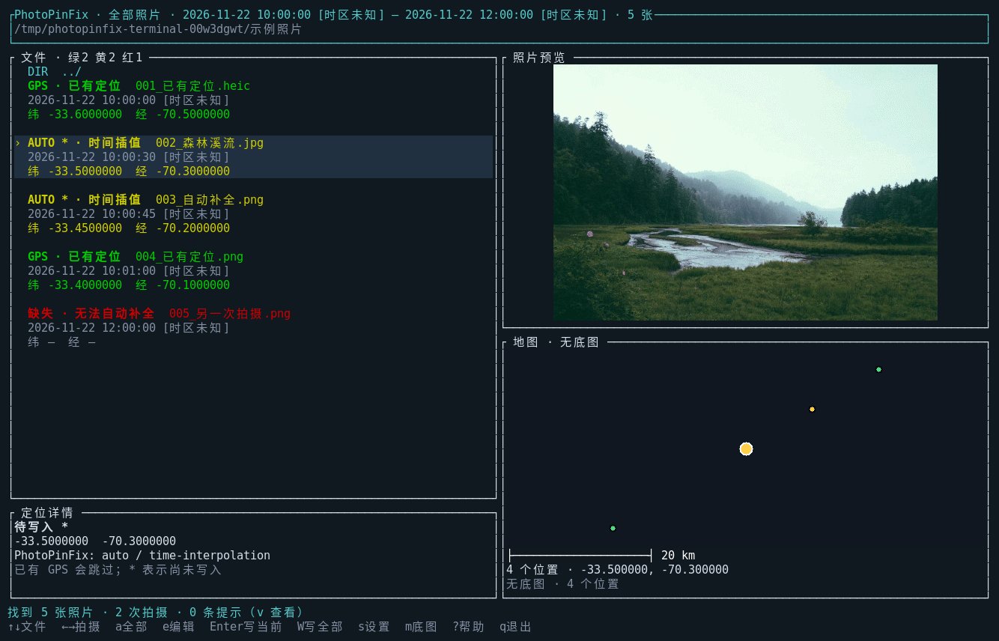

# PhotoPinFix

给缺失 GPS 的照片补上位置。PhotoPinFix 根据同批照片的拍摄时间和已有定位生成建议，你可以预览、调整，再确认写入。

支持 JPEG、PNG、HEIF / HEIC 和 Sony、Canon、Nikon、Leica 等相机的 RAW。同一个程序提供桌面 GUI 和终端 TUI，运行无需安装 Rust、Python、Perl 或 ExifTool。


截图中的拍摄时间和 GPS 为演示数据，不代表景物的真实位置。

## 下载与启动

登录 GitHub，打开 [Actions](https://github.com/Animadverto-mundum/PhotoPinFix/actions/workflows/ci.yml)，选择最近一次成功的运行，在 **Artifacts** 下载对应平台的 **app** 包：

| 平台 | 下载名称 |
| --- | --- |
| Windows x64 | `photopinfix-x86_64-pc-windows-msvc-app` |
| macOS Apple Silicon（M 系列） | `photopinfix-aarch64-apple-darwin-app` |
| Linux x64 | `photopinfix-x86_64-unknown-linux-gnu-app` |

先解开下载的 ZIP，再解开里面的 `.tar.gz`，进入 `photopinfix-<平台>-app` 文件夹。程序就在其中；不需要下载 **source** 包或编译源码。测试包保留 7 天，目前不自动发布 GitHub Release。

**Linux / macOS：**

```bash
./photopinfix --gui
```

**Windows PowerShell：**

```powershell
.\photopinfix.exe --gui
```

打开后点击 **选择照片文件夹**，在系统的文件夹选择窗口中打开照片目录。也可以直接指定目录，例如 `./photopinfix --gui "照片目录"`。窗口启动成功后，终端会返回命令提示符；关闭终端也能继续使用 GUI。

去掉 `--gui` 就是终端界面；TUI 不传目录时打开当前目录。下载包不包含演示照片。

GUI 需要图形桌面。Linux 使用 X11 / Wayland；Debian / Ubuntu 的 X11 环境如果提示缺少 `libxkbcommon-x11.so.0`，安装 `libxkbcommon-x11-0` 即可。通过 SSH 使用时可选择 TUI，它会自动检测终端图片协议，不支持时使用字符预览。

## 使用方法

宽窗口中，左侧是照片库，中间预览图片，右侧编辑坐标和查看地图；窄窗口通过页签切换预览、地图和照片位置。GUI / TUI 按当前 session（或全部照片）统计以下五种状态：

| 状态 | 含义 |
| --- | --- |
| 原有 GPS · 绿 | 原本带有 GPS，保留原位置 |
| 自动待写 · 黄 | 缺失 GPS，已有自动建议，尚未写入 |
| 待指定 · 红 | 缺失 GPS，无法自动补全，还需要指定位置 |
| 手动待写 · 紫 | 缺失 GPS，已手动指定，尚未写入 |
| 已写入 · 蓝 / 青 | 原本缺失 GPS，已经由 PhotoPinFix 写入 |

进度中的「原本缺失」包含已写入的照片；「已指定」包含自动建议、手动指定和已写入。**上一张缺失 / 下一张缺失**（快捷键 **[ / ]**）跳转到尚未写入 GPS 的照片，包括已指定位置的照片。

默认将拍摄间隔超过 1 小时的照片分为不同 session。自动补全沿相邻间隔小于 1 分钟的照片寻找参考，每侧最多追溯 10 分钟：两侧都有位置时按时间插值，只有一侧时复制该位置。阈值可在设置中调整，仅本次运行生效。

坐标可以直接编辑，支持小数、度分秒，以及正负号或 N / S / E / W。地图默认只显示照片位置，无需联网；需要时可开启底图。切换 session 时点位立即更新，底图加载期间显示转圈提示。


编辑只暂存建议。按 **Enter** 写入当前照片，**Shift+Enter**（或 **W**）写入当前 session / 全部视图中的候选；两者都会再次确认。写入时保持本次写入前的创建、修改和访问时间。已有 GPS 不会被覆盖。

GUI 和 TUI 设置都有 **保留原图备份**，默认关闭，仅本次运行生效。写入前会创建 `<原文件名>.photopinfix-original`；每张照片写入、校验及时间恢复成功后，立即删除它自己的备份。开启此选项后，成功写入也会保留备份。失败时保留已创建的备份；已有的备份不会被自动清理或覆盖。

文件时间保护覆盖 PhotoPinFix 自身的读取和写入。macOS 系统文件夹选择器显示照片时可能更新访问时间；需要保留打开目录前的访问时间时，请通过目录输入框或启动参数指定路径。

桌面界面可直接使用按钮；设置、刷新和返回上级目录位于右上角的 **更多** 菜单。

## 终端界面

不加 `--gui` 即可在终端使用：

```bash
./photopinfix "照片目录"
```



终端会自动选择图片显示方式，定位策略和写入确认与桌面界面一致。

TUI 常用按键：

| 按键 | 功能 |
| --- | --- |
| ↑ / ↓ | 选择照片 |
| ← / →、a | 切换 session；切换显示全部 |
| e | 编辑 GPS |
| [ / ] | 上一张 / 下一张缺失 GPS 的照片 |
| p / n / c / i | 复制前方 / 后方 / 最近位置，或按时间插值 |
| s、?、q | 设置、帮助、退出 |

源码构建、测试、完整快捷键和文件时间说明见 [开发文档](docs/DEVELOPMENT.md)。第三方组件见 [许可说明](THIRD_PARTY_NOTICES.md)。
